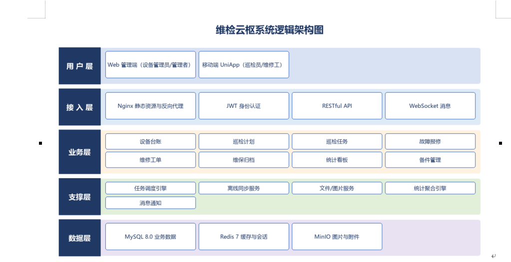
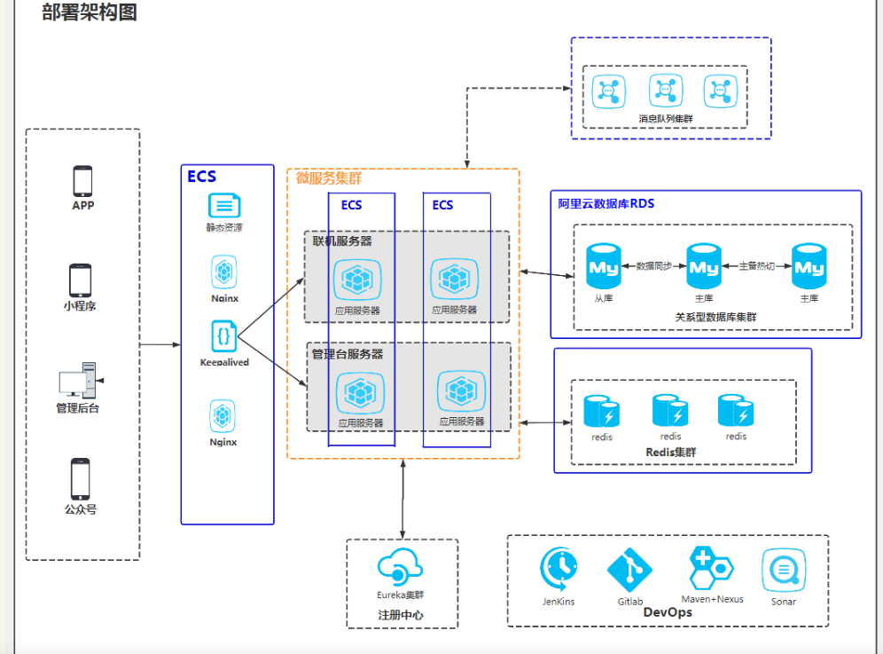

# Architecture views: logical and deployment

## Distinguish the two views

| View | Question | Elements | Must not contain |
| --- | --- | --- | --- |
| Logical architecture (`logical_architecture`) | What logical layers/components exist, what are their responsibilities, and which dependencies are allowed? | Layers, components/services, interfaces/connectors, dependency direction | Servers, IPs, ports, cloud instances, runtime topology |
| Deployment (`deployment`) | Which runtime nodes, execution environments, artifacts, and communication paths exist? | Nodes, execution environments, deployed artifacts, databases/caches, protocols/ports, external systems | Business activities, logical layer bands, module call hierarchy |

A logical component may be deployed on several nodes; a node may host several components. Do not collapse these two facts into one figure unless the report explicitly labels a combined “logical + deployment” view.

## Authority

- **ISO/IEC/IEEE 42010:2022** defines architecture descriptions, stakeholders, concerns, views, and viewpoints. It does not mandate a fixed layer graphic; it requires the view to answer the stated concerns.
- **OMG UML 2.5.1** is the formal notation for UML component and deployment diagrams: components, provided/required interfaces, nodes, execution environments, artifacts, communication paths.
- **Bass, Clements & Kazman, _Software Architecture in Practice_, 4th ed. (2021)** is a canonical architecture textbook for views, tactics, and quality attributes.
- **Richards & Ford, _Fundamentals of Software Architecture_ (2020)** is a practical reference for layered architecture and architecture styles.
- **C4 model** (Simon Brown, [c4model.com](https://c4model.com/)) is a widely used **de facto** convention for context/container/component/deployment views. It is not an ISO standard; label it as C4 if you use its vocabulary.

## Logical architecture rules

- Start from the concerns: separation of concerns, dependency direction, replaceability, and quality attributes. A layer diagram that only lists technologies is a technology stack, not an architecture rationale.
- Give each layer/component a one-line responsibility. Avoid a “业务层” that mixes business services, technical support, and reporting without a boundary.
- Show the allowed dependency direction explicitly (normally upper layers depend downward). A cycle between layers is a design smell; if it is intentional, annotate it.
- Distinguish **layer** (logical grouping) from **component/service** (deployable or replaceable unit). Do not put a database icon in a logical layer unless you mean a logical data-access component.
- If you use UML component notation, show provided/required interfaces and ports; if you use boxes, state that the boxes are logical components, not UML components.
- Do not include IP addresses, VM sizes, or cloud regions; those belong to deployment.

### Example evidence

The P3 example is a five-layer logical view: 用户层 / 接入层 / 业务层 / 支撑层 / 数据层. It is a logical view because it has no runtime nodes or server topology. Its weak point is that “业务层” mixes business modules (设备台账、巡检计划) with support/reporting capabilities (统计看板、备件管理); either rename it “业务与支撑组件” or split the layer.

## Deployment rules

- A node is a runtime computational resource (physical server, VM, container host, cloud instance, device). An execution environment is what runs inside it (JVM, container runtime, browser); an artifact is what is deployed (JAR, WAR, container image, static bundle).
- Show communication paths with protocol/port where known (`HTTPS/443`, `MySQL/3306`, `Redis/6379`). If unknown, use `TBD`, not a guessed port.
- Show external systems and trust boundaries; distinguish private network from public ingress.
- Show redundancy/replication only when it is a real deployment fact; do not draw two instances “for symmetry”.
- Vendor icons are allowed for readability, but every icon must have a text label and a legend if its meaning is not universal. Vendor icon sets are not a neutral standard.
- Do not turn a deployment view into a business flow: an arrow between nodes means a communication path, not “then the user does X”.

### Example evidence

The P6 example is a cloud deployment view: clients (APP/小程序/管理后台/公众号), ECS, RDS, Redis, message queue, Eureka, and DevOps tools. It is a deployment view because the boxes are runtime nodes/services. Its weak points are vendor-specific icons without a legend and missing protocol/port labels on most connections.

## Validation checks

Logical:
- At least two layers or logical components.
- Every component has a responsibility; every dependency connects declared components.
- No runtime node/IP/port fields.
- No cycles unless explicitly justified.

Deployment:
- At least one node; every edge connects declared nodes.
- Every node has a type (`node`, `execution_environment`, `database`, `cache`, `external_system`, etc.).
- Communication paths have protocol/port or `TBD`.
- No business activities or logical layer bands.
