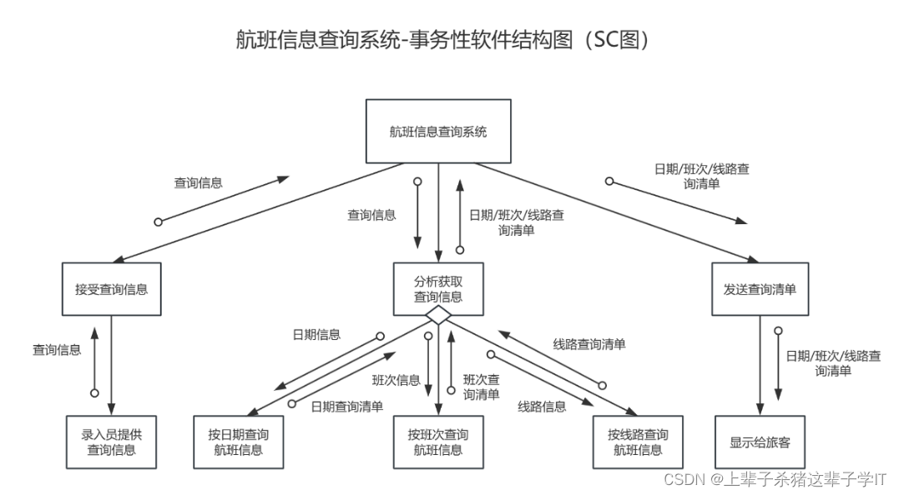
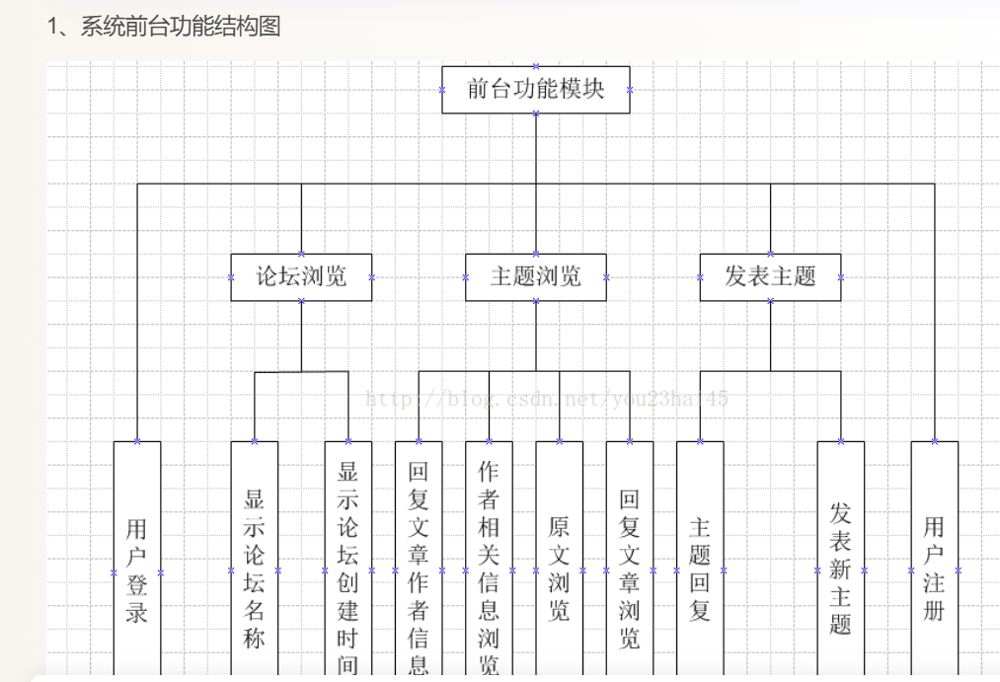
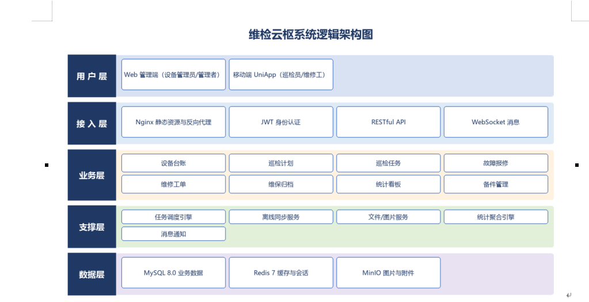
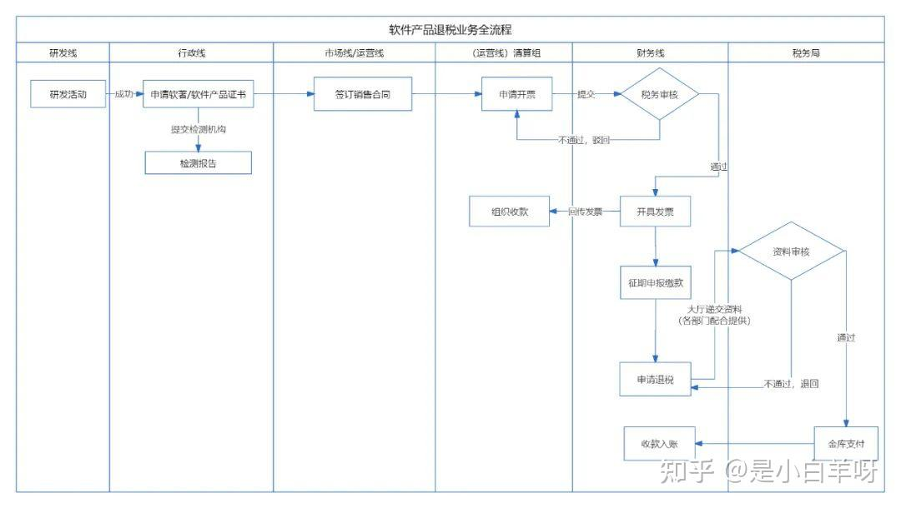
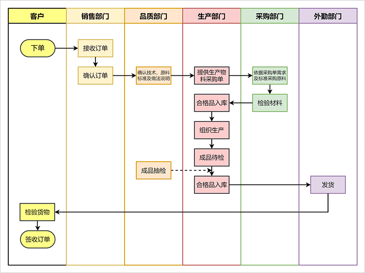
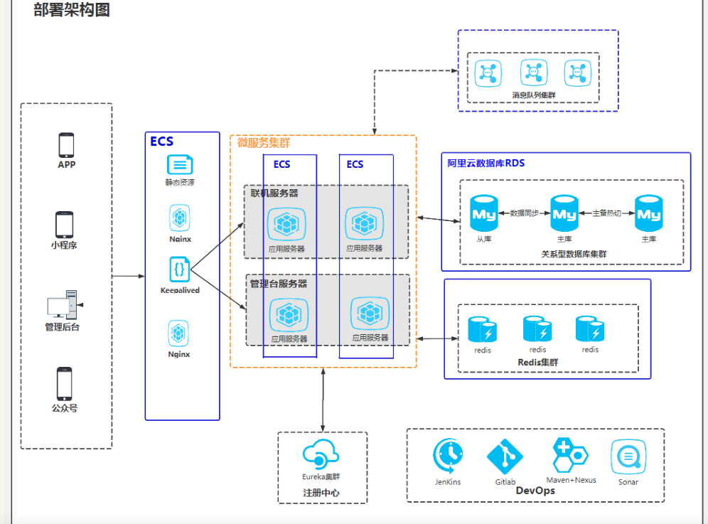
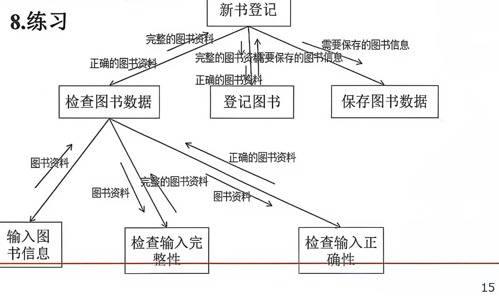
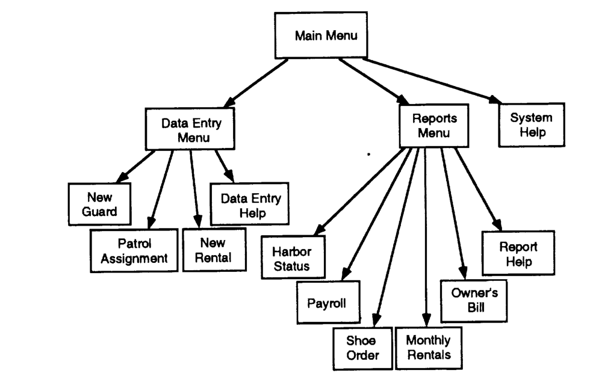
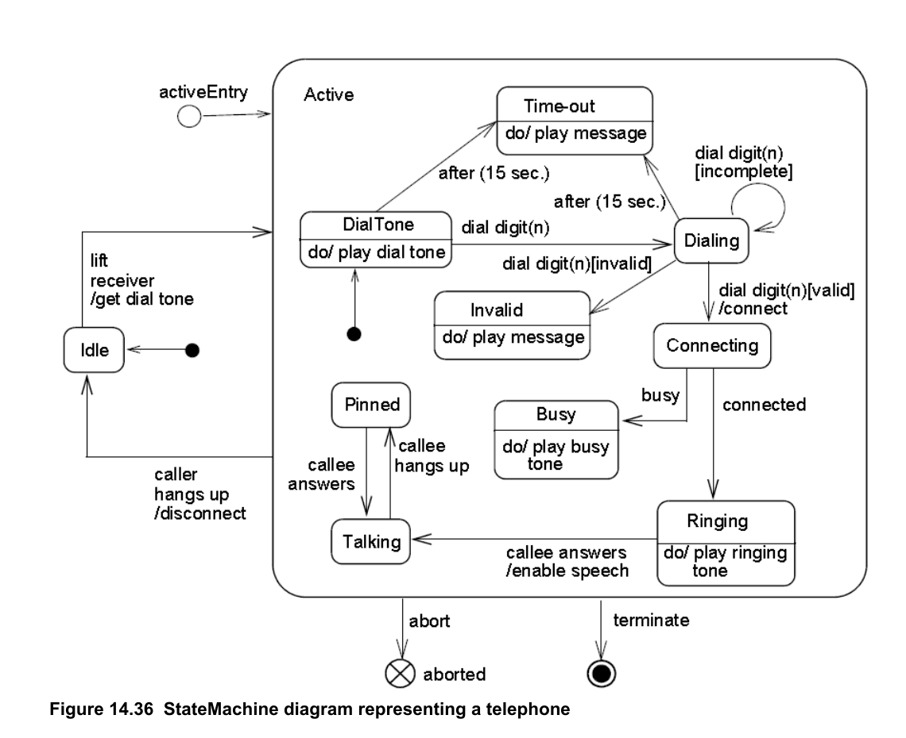

# Authority map for the six report figures

This file separates **formal standards**, **canonical textbooks/government guidance**, and **de facto conventions**. Do not call a diagram “standardized” when it is only a textbook convention.

## Evidence levels

| Level | Meaning | Examples |
| --- | --- | --- |
| A. Formal standard | Published by a recognized standards body; symbols/semantics are normative | OMG UML 2.5.1, OMG BPMN 2.0.2, ISO 5807:1985, ISO/IEC/IEEE 42010:2022 |
| B. Canonical method/textbook | The origin or accepted teaching source for a technique; widely cited but not a formal symbol standard | Yourdon & Constantine, *Structured Design* (1979); Bass, Clements & Kazman, *Software Architecture in Practice* |
| C. Government/industry guide | Public technical guidance with a traceable author and figure | NASA CR-177625, *Software Engineering Guidebook* (1993), Figure 4.1-6 |
| D. De facto convention | Widely used but not standardized; must be declared as a convention | C4 model; cloud-vendor icon sets; simple swimlane columns |

## The six figures

| Chinese term | Model type in the skill | Core question | Not this |
| --- | --- | --- | --- |
| 系统结构图 / SC 图 / 模块结构图 | `structure_chart` | Which modules call which modules, and what data/control couples pass between them? | 功能结构图、流程图、状态图 |
| 系统功能结构图 | `functional_decomposition` | How is a capability decomposed into sub-functions? | SC 的调用箭头、数据/控制偶、执行顺序 |
| 系统逻辑架构图 | `logical_architecture` | What logical layers/components exist, what are their responsibilities, and which dependencies are allowed? | 部署节点、IP/端口、服务器拓扑 |
| 基本业务流程图 | `business_flow` with `flow_variant: basic` | A single role processes one business matter in what activity/decision order? | 多角色泳道、程序控制流、DFD |
| 跨职能业务流程图 | `business_flow` with `flow_variant: cross_functional` | Multiple roles/departments hand off a business matter in what order? | 单角色流程、模块调用图、纯组织架构图 |
| 部署架构图 | `deployment` | Which runtime nodes, execution environments, artifacts, and communication paths exist? | 逻辑分层、业务流程图、模块调用图 |

## Source-to-claim table

| Claim in this skill | Source | Level | Use |
| --- | --- | --- | --- |
| SC shows modules, procedural dependencies/calls, and parameters/flags (data/control couples). | J. Connell & G. Wenneson, *Software Engineering Guidebook*, NASA CR-177625, 1993, §4.1.2.3 and Figure 4.1-6, p.21. [PDF](https://ntrs.nasa.gov/api/citations/19940012183/downloads/19940012183.pdf) | C | Definition and an authoritative example |
| SC originates in structured design; transform analysis and transaction analysis produce different SC shapes. | E. Yourdon & L. Constantine, *Structured Design: Fundamentals of a Discipline of Computer Program and Systems Design*, Prentice Hall, 1979. | B | Canonical method; transaction/transform variants |
| Transaction structure charts have a transaction centre that dispatches to transaction modules. | Yourdon & Constantine (1979); NASA CR-177625 §4.1.2.3. | B/C | Explains the P1/A1 examples |
| A transform structure chart has input/afferent, central-transform, and output/efferent branches. | Yourdon & Constantine (1979), transform analysis; P7 teaching example. | B/D | Default SC shape when the DFD has an input–process–output structure |
| Functional decomposition is an `is composed of` hierarchy, not an invocation graph. | IEEE 1016-2009, *Software Design Descriptions* (design views); standard software-engineering texts on functional decomposition. | A/B | Distinguishes P2 from P1 |
| Logical architecture is a view of components, responsibilities, and allowed dependencies, independent of runtime nodes. | ISO/IEC/IEEE 42010:2022, *Software, systems and enterprise — Architecture description*; Bass, Clements & Kazman, *Software Architecture in Practice*, 4th ed., 2021. | A/B | P3 |
| Layered logical architecture is a style, not a single mandated symbol set. | Bass, Clements & Kazman (2021); Richards & Ford, *Fundamentals of Software Architecture*, 2020. | B | P3 |
| BPMN is the standard notation for business processes, including pools and lanes for cross-functional processes. | OMG, *Business Process Model and Notation (BPMN) 2.0.2*, 2013. [PDF](https://www.omg.org/spec/BPMN/2.0.2/PDF) | A | P4/P5 |
| Basic flowchart symbols are standardized separately from business-process semantics. | ISO 5807:1985, *Information processing — Documentation symbols and conventions for data, program and system flowcharts*. | A | Basic business flow when BPMN is not used |
| Cross-functional swimlanes are a layout convention unless they use BPMN pools/lanes semantics. | OMG BPMN 2.0.2; common swimlane practice. | A/D | P4/P5; declare the convention |
| UML deployment diagrams show nodes, execution environments, artifacts, and communication paths. | OMG, *Unified Modeling Language 2.5.1*, 2017, Deployment Diagrams clause. [PDF](https://www.omg.org/spec/UML/2.5.1/PDF) | A | P6 if UML notation is used |
| C4 deployment diagrams are a de facto architecture-description convention, not an ISO standard. | S. Brown, *The C4 model for visualising software architecture*. [c4model.com](https://c4model.com/) | D | P6 alternative |
| Cloud-vendor icons are vendor-specific, not a neutral standard. | Vendor icon sets (e.g., Alibaba Cloud, AWS, Azure). | D | P6; add a legend and text labels |

## Example-evidence notes (P1–P6)

These notes treat the supplied images as **examples**, not as normative sources. The images are stored under `references/examples/` so a human reviewer can compare the expected visual grammar with the definition. Check third-party rights before redistributing them outside the project.

| ID | Example image | What it demonstrates | Evidence level / caveat |
| --- | --- | --- | --- |
| P1 |  | SC with module hierarchy, call arrows, data couples and a transaction centre | User example; visual grammar matches NASA/Yourdon SC, but the root label should be a module, not the whole system |
| P2 |  | Functional decomposition tree, parent–child only | User example; **not** an SC because it has no call arrows or couples |
| P3 |  | Layered logical architecture (user/access/business/support/data) | User example; add allowed dependency direction and layer responsibilities |
| P4 |  | Cross-functional flow with department columns and decision handoffs | User example; **cross-functional**, not a basic single-role flow |
| P5 |  | Cross-functional swimlane flow with customer/sales/quality/production/purchasing/field lanes | User example; label dashed/exception paths |
| P6 |  | Deployment view with runtime nodes, DB/cache/MQ, registry and DevOps tools | User example; vendor icons need a legend and protocols/ports |
| P7 |  | Transform-type SC: input branch (`检查图书数据`), central transform (`登记图书`), output branch (`保存图书数据`) | User-provided teaching example; use as the default visual grammar for a transform SC, not as a formal standard |

### Authoritative comparison images

These are included as source evidence, not as user examples:

| ID | Image | Source |
| --- | --- | --- |
| A1 |  | NASA CR-177625, *Software Engineering Guidebook*, 1993, Figure 4.1-6, p.21 — a transaction-type example |
| A2 |  | OMG UML 2.5.1, Figure 14.36, p.336 |

### P1 — 事务性软件结构图（SC）

The image is a **transaction structure chart**: a root module dispatches to “接受查询信息 / 分析获取查询信息 / 发送查询清单”, and the analysis module dispatches to date-, shift-, and route-based query modules. The open circles on the call arrows are **data couples** (`查询信息`, `日期/班次/线路查询清单`). This is a valid SC example because it shows module hierarchy, calls, and data couples.

Audit note: label the root as a **main control module** (e.g., “航班信息查询主控模块”), not as the whole system. A system name in the root box blurs “system” and “module”.

### P2 — 系统功能结构图

The image is a **functional decomposition tree**: “前台功能模块” is decomposed into “论坛浏览 / 主题浏览 / 发表主题”, then into leaf functions. It has no call arrows and no data/control couples, so it is **not** an SC. This is the key distinction: P1 has arrows + couples; P2 only has parent–child decomposition.

Audit note: keep siblings at the same abstraction level. “用户登录 / 用户注册” are user-facing capabilities; “显示论坛名称 / 显示论坛创建时间” are presentation details under 论坛浏览. Mixing them at the same level makes the decomposition uneven.

### P3 — 系统逻辑架构图

The image is a **layered logical architecture**: 用户层 / 接入层 / 业务层 / 支撑层 / 数据层, with technology boxes inside. It is not a deployment diagram because it has no runtime nodes, IPs, or server topology.

Audit note: add the **allowed dependency direction** (normally upper layers depend downward) and a one-line responsibility for each layer. “业务层” currently mixes business modules (设备台账、巡检计划) with technical capabilities (统计看板、备件管理); either relabel it “业务组件” or split business services from support services.

### P4 — 跨职能业务流程图（部门列）

The image uses vertical columns for 研发线 / 行政线 / 市场线/运营线 / 清算组 / 财务线 / 税务局. That is a **cross-functional** view: multiple roles/departments hand off a business matter. It is not a basic single-role flow.

Audit note: label every handoff (the arrow between columns) with the document/decision passed; otherwise the reader sees “who does what” but not “what is handed over”.

### P5 — 跨职能业务流程图（泳道）

The image uses horizontal lanes for 客户 / 销售部门 / 品质部门 / 生产部门 / 采购部门 / 外勤部门. It is also a **cross-functional** view. The dashed line from 成品抽检 to 合格品入库 should be labelled as a quality-release/exception path; otherwise the line style is unexplained.

### P6 — 部署架构图

The image shows runtime nodes (APP/小程序/管理后台/公众号), ECS, RDS, Redis, message queue, Eureka, DevOps tools. This is a **deployment** view, not a logical architecture view. Vendor icons are acceptable as a convenience, but the diagram must add node labels, protocols/ports, and a legend for any icon whose meaning is not universal.

### P7 — 变换型结构图（Transform SC）

The image is a **transform-type SC** for 新书登记: `检查图书数据` is the input/afferent branch with `输入图书信息`, `检查输入完整性`, `检查输入正确性`; `登记图书` is the central transform; `保存图书数据` is the output/efferent branch. Call labels such as `完整的图书资料`, `正确的图书资料`, `需要保存的图书信息` are **data couples**.

Note the visual grammar: the **call arrows** (control transfer) and the **couple arrows** (small side arrows with open circles/labels) are separate. A structure chart that only writes `D:`/`C:` on the call arrow has not drawn the couple arrows; add the extra arrows and a legend.

This is the **default visual grammar for a “系统结构图” when the DFD has an input–processing–output shape**. The NASA A1 and P1 examples are transaction-type charts; do not use them as the default for every SC.

Audit note: keep the three branches semantically distinct. Do not draw business-flow arrows between `检查图书数据` and `保存图书数据`; the hierarchy is a call decomposition, not a chronological process.

## What the skill should enforce

1. **Name the view before drawing.** “系统结构图” is not a synonym for “系统功能结构图”; “逻辑架构图” is not a deployment diagram; “业务流程图” is not a program flowchart.
2. **Use one notation per figure.** Do not mix SC call arrows with functional tree lines, or BPMN pools with arbitrary swimlane columns without saying so.
3. **Record the authority level.** In the IR, set `notation` to the actual notation (`structure_chart`, `functional_decomposition`, `layered_architecture`, `bpmn_2_0_2`, `iso_5807`, `uml_2_5_1_deployment`, `c4_deployment`, etc.) and list the source in `source_requirements`.
4. **Mark de facto conventions.** C4, vendor icons, and simple swimlanes are allowed, but label them as conventions, not standards.
5. **Add a legend when the symbol set is not self-evident.** This is especially important for data/control couples, swimlane handoffs, and cloud icons.
