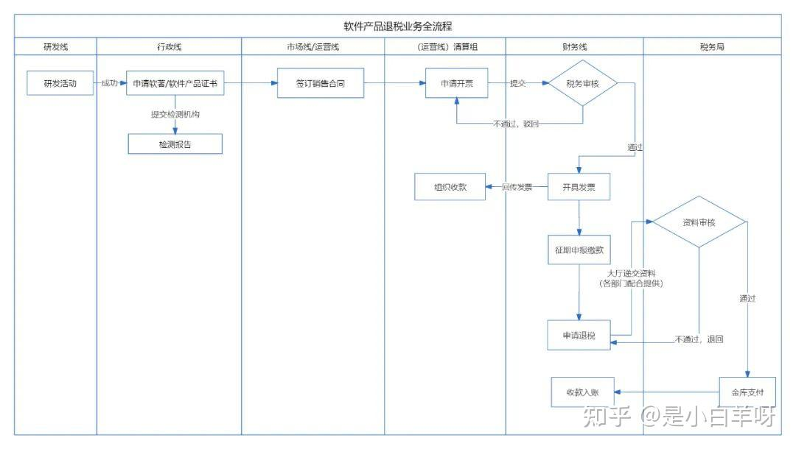
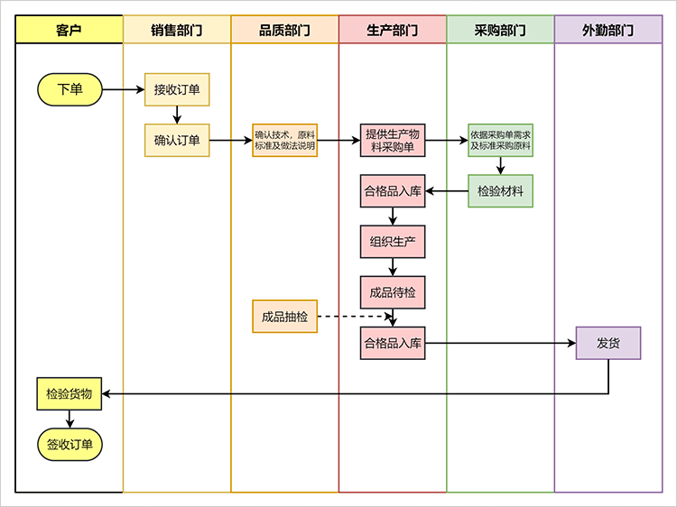

# Business process flows: basic and cross-functional

## First decide the variant

| Variant | Question | Typical layout | Not this |
| --- | --- | --- | --- |
| Basic business flow (`flow_variant: basic`) | One role handles one business matter in what activity/decision order? | One lane or no lanes; start → activities/decision → end | Multiple departments handing off work; program control flow |
| Cross-functional business flow (`flow_variant: cross_functional`) | Multiple roles/departments hand off a business matter in what order? | Pools/lanes or vertical/horizontal role columns | A single-role procedure; a module call graph; an org chart |

A cross-functional flow is not “a basic flow with decorations”. The lanes are semantic: they identify **who is responsible** for each activity and where a handoff occurs.

## Authority

- **BPMN 2.0.2** (OMG, 2013) is the formal standard for business process models: pools, lanes, tasks, events, gateways, sequence flows, message flows. Use BPMN when the reader needs precise process semantics.
- **ISO 5807:1985** standardizes basic flowchart symbols (process, decision, input/output, start/end, connectors). Use it for a simple single-role flow when BPMN is too heavy, but do not call a BPMN collaboration “ISO 5807”.
- A plain swimlane flowchart with role columns is a **layout convention**, not a separate formal standard. If you use it, state that the lanes are roles and label every handoff. BPMN pools/lanes are the standardized version of the same idea.
- See [authority-map.md](authority-map.md) for source levels.

## Basic flow rules

- One role/one organizational unit; if a second role appears, promote the figure to cross-functional.
- Use a clear start and end; every decision has labelled outcomes (`是/否`, `通过/不通过`).
- Put the action verb first in activity labels (`校验申请`, `录入检测结果`), not a noun phrase.
- Do not model system internals (tables, services, queues) as activities; a business flow shows business work, not a sequence diagram.
- Do not use BPMN gateways in a plain flowchart unless you are actually using BPMN; use a diamond with labelled exits.

## Cross-functional rules

- Assign every activity to exactly one lane/role; an activity that genuinely needs two roles should be split or marked as a joint task.
- Label handoffs with the object being passed: `提交申请`, `返回修改意见`, `移交检测报告`. An unlabelled arrow between lanes is not a handoff.
- Use lanes for **roles/departments**, not for systems or data stores. A system can be a separate participant only if it performs work (for example, an external approval service).
- Keep the primary happy path on one reading direction; put rejection/exception paths on a secondary path and label them.
- If using a dashed line, define it: message/information flow vs material flow vs exception path. Do not leave line style unexplained.

## Example evidence

The two supplied examples are **both cross-functional**, not basic:

- **P4** uses vertical columns for 研发线 / 行政线 / 市场线·运营线 / 清算组 / 财务线 / 税务局. The columns are departments, and the arrows across columns are handoffs. This is a cross-functional flow.
- **P5** uses horizontal lanes for 客户 / 销售部门 / 品质部门 / 生产部门 / 采购部门 / 外勤部门. It is also cross-functional. The dashed line from 成品抽检 to 合格品入库 needs a legend (quality release/exception path).

Neither image is a basic single-role flow. If a report needs a basic flow, use one role lane and a simple start→activity/decision→end path, or use BPMN with a single pool and no lanes.

## Validation checks

- `flow_variant` must be `basic` or `cross_functional`.
- `basic`: at most one role; `cross_functional`: at least two roles/lanes.
- Every activity has a role/lane; every handoff has a label.
- Every decision has at least two labelled outcomes.
- Start and end are explicit; no dangling activities.
- A dashed line has a legend and a meaning.
