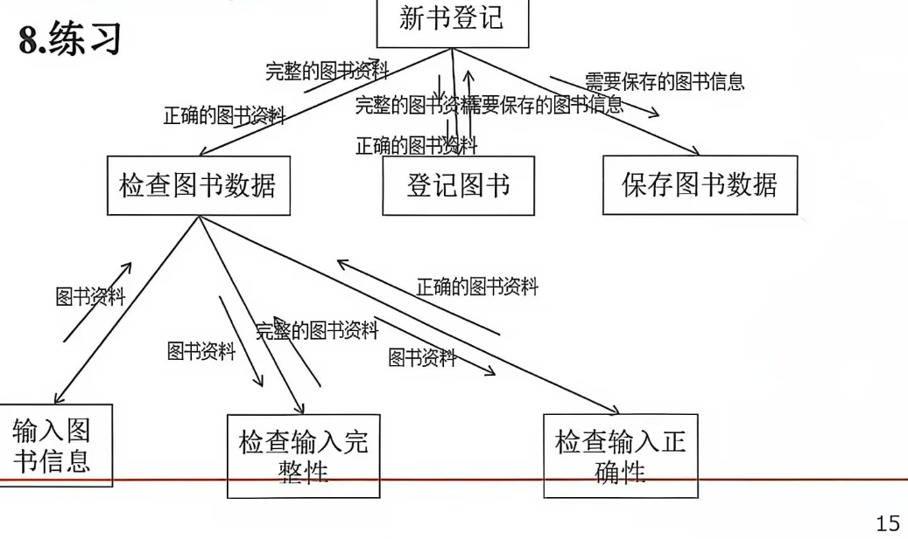
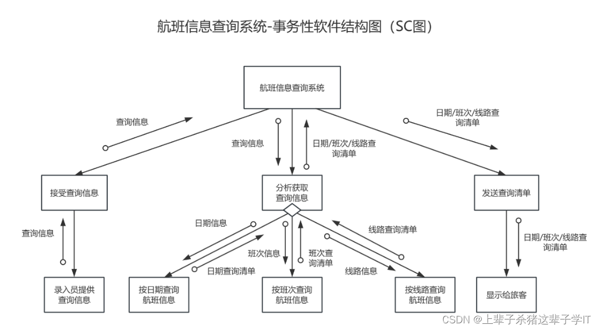
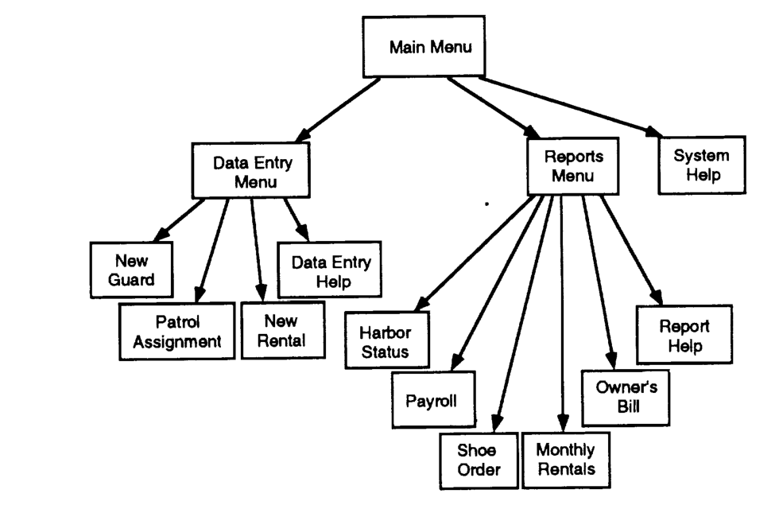
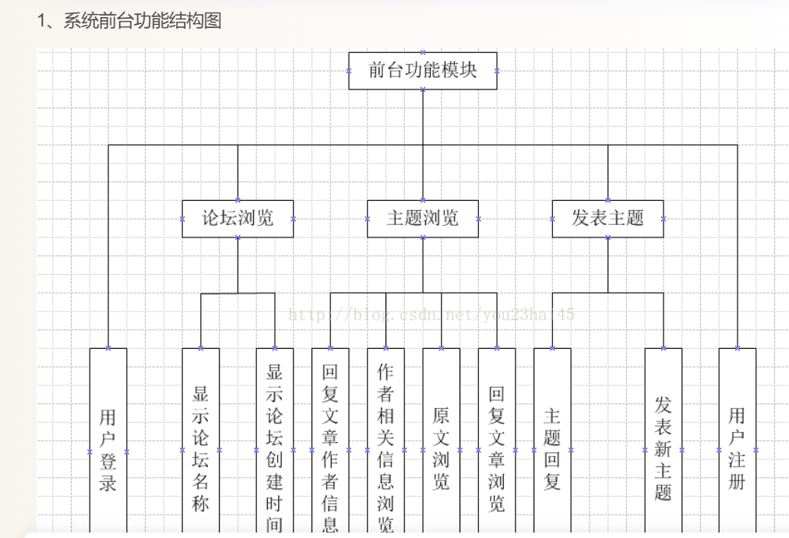

# Structure Chart and functional decomposition

## First disambiguate `SC`

`SC` may mean **Structure Chart** (structured-design module hierarchy) or **Statechart** (state machine). Ask when the user has not expanded the abbreviation. Do not treat “系统结构图” as a synonym for “系统功能结构图” until the call/couple semantics are checked.

Read [authority-map.md](authority-map.md) for source levels and the P1/P2/P7 example notes.

## Structure Chart (SC)

### Definition

A Structure Chart is a hierarchical design diagram of **software modules**. It shows:

- modules as rectangles;
- procedural dependencies/calls as directed vectors;
- parameters and flags as labelled **data couples** (normally an open circle) and **control couples** (normally a filled circle);
- conditional calls (diamond) and iteration (curved arrow) only when those design facts are known.

It is a **module/call view**, not a chronological user flow, not a function tree, and not a flowchart. It is produced in structured design by transform analysis or transaction analysis.

### Default: transform-type SC

When the user says “系统结构图” / “SC 图” without specifying the variant, and the DFD has a clear input → processing → output shape, **default to a transform-type Structure Chart**, not a transaction-type chart.

Transform analysis produces three branches under the main control module:

1. **Input/afferent branch**: acquire and validate the input (for example, read plans, check completeness, check correctness).
2. **Central transform**: the core calculation/registration step.
3. **Output/efferent branch**: save, dispatch, log, or notify.

A transform SC is still a module/call diagram. The three branches are a design decomposition, not a chronological sequence; do not draw arrows between sibling branches as if they were a business flow.

Use a **transaction-type SC** only when the evidence shows a transaction centre: a module inspects a transaction type and dispatches to one of several transaction modules (for example, menu choice, document type, query type). The NASA example and the P1 example are transaction-type charts; the P7 example is transform-type.

### Transform vs transaction

| Variant | Shape | Use when | Do not use when |
| --- | --- | --- | --- |
| Transform | input branch + central transform + output branch | DFD has a clear input–process–output structure | There is a dominant dispatch-by-type centre |
| Transaction | transaction centre + dispatch + transaction modules | DFD has a transaction centre and multiple transaction types | The process is a single input–transform–output chain |

The choice is a design judgement; record the evidence (DFD shape, transaction types) in the IR, not just the title.

### Rules

- A module is a stable responsibility with a callable interface, not a user action or a page.
- The root is the **main control module**; do not label it with the whole system name.
- **Keep the call arrow and the couple arrows separate.** The call arrow means control transfer/invocation. A data couple is an additional small arrow with an open circle at its tail; a control couple is an additional small arrow with a filled circle. Do not make a call arrow's label (`D: ...` / `C: ...`) the only representation of a couple.
- Put data couples and control couples on the call they belong to; do not draw free-floating arrows. Label the couple arrow with the data/flag name.
- Use a diamond only for a conditional call; use a loop arc only for an actual iteration.
- Keep the hierarchy readable: one module should not have a fan-out that turns the figure into a star; split by subfunction if needed.
- Do not infer a data couple from matching names; require a requirement or design fact.
- A structure chart with no data/control couples may still be valid, but it proves only hierarchy/calls, not interface design.
- If the renderer cannot draw a true side arrow, use a **distinct thin grey parallel arrow** with the open/filled circle and a legend; never silently merge the couple into the call arrow.

### Symbols

| Symbol | Meaning |
| --- | --- |
| Rectangle | Module |
| Directed arrow | Call / procedural dependency |
| Open-circle mini arrow | Data couple, labelled with the data passed |
| Filled-circle mini arrow | Control couple, labelled with the flag |
| Diamond | Conditional call |
| Curved arrow | Iteration/loop |

Different textbooks vary the couple symbols; state the convention in the figure note if it matters.

### Example evidence

The P7 example is a **transform-type SC** for “新书登记”: `检查图书数据` is the input branch (with `输入图书信息 / 检查输入完整性 / 检查输入正确性`), `登记图书` is the central transform, and `保存图书数据` is the output branch. The labels on the calls are data couples.

The P1 example is a **transaction-type SC**: a transaction centre dispatches to date/shift/route query modules. The open circles are data couples.

The NASA figure is the authoritative comparison for a transaction-type chart:

Do not use the NASA/P1 transaction chart as the default template for every “系统结构图”. Use P7's input–central–output shape when the DFD supports it.

## Functional decomposition / functional structure chart

Use this only to show an **`is composed of` hierarchy** of capabilities/functions. It is a tree of functions, not modules with calls.

- **Default layout: top-down vertical extension** — root at the top, children below, like the P2 example. Do not switch to a left-to-right horizontal tree unless the page width forces it; vertical extension is the expected reading direction for a Chinese “系统功能结构图”.
- **Each function box is a portrait rectangle** (height ≥ width), with a short 2–4 line label. Do not draw wide landscape bars: they flatten the hierarchy and read like table cells rather than levels.
- Parent function decomposes into child functions at a comparable abstraction level.
- No call arrows, data couples, control couples, loops, decisions, or state transitions.
- Siblings should be mutually distinguishable and at the same level of detail.
- A cross-link is allowed only when the report explicitly needs a non-tree dependency; otherwise keep it a tree.
- If the figure is too wide, add a **logical grouping level** (for example, “基础与设备 / 巡检 / 维修与维保 / 备件与统计”) and say it is a view grouping, not a new function. Do not silently change the module list.

“系统功能结构图” in a Chinese report normally means this functional decomposition, **not** an SC. If the figure has arrows with open/filled circles, it is an SC; if it only has parent–child lines, it is a functional decomposition.

### Example evidence

The P2 example is a **functional decomposition**: it has only parent–child function lines, no call arrows and no couples, and it extends vertically from the root.

## Authority

- NASA CR-177625, *Software Engineering Guidebook*, 1993, §4.1.2.3 and Figure 4.1-6: definition and a transaction-type SC example.
- Yourdon & Constantine, *Structured Design*, 1979: canonical method, transform/transaction analysis.
- IEEE 1016-2009: design-description viewpoints (functional view vs module/call view).
- See [authority-map.md](authority-map.md) for the full source table and P7 evidence note.
