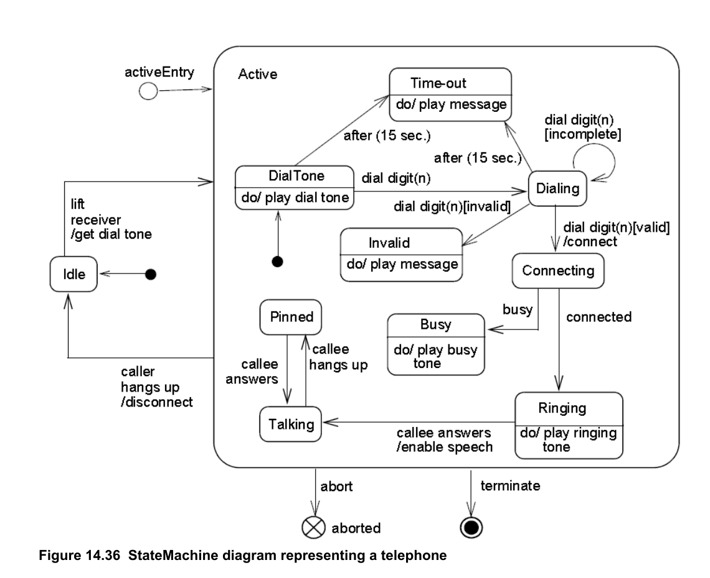

# UML diagram rules

Use UML 2.5.1 semantics and choose the smallest diagram that answers the reader's question.

- **Use case**: actors interact with named system capabilities inside a system boundary. `include` and `extend` are directed relationships with distinct meanings; do not use them as generic arrows.
- **Sequence**: lifelines show participants; time progresses downward. Use messages for interactions and `alt`, `opt`, `loop`, or similar combined fragments for conditional behavior. Do not draw a flowchart diamond.
- **Activity**: distinguish actions, decision/merge, fork/join, initial and final nodes. It is behavior/control flow, not a DFD.
- **State machine**: show states, event-triggered transitions, guards, effects, and initial/final pseudostates as applicable. A state is not a call-stack frame. OMG UML 2.5.1 Figure 14.36 is an authoritative telephone example; see [authority-map.md](authority-map.md).
- **Component/deployment**: show provided/required interfaces, components/artifacts, nodes/environments, and communication paths; do not use them to narrate a business workflow. For the distinction between logical architecture and deployment, read [architecture-views.md](architecture-views.md).

Record unspecified message synchronicity, guards, or interface direction as `TBD` rather than inventing it.

Authoritative state-machine example (OMG UML 2.5.1, Figure 14.36):

Reference: OMG, *Unified Modeling Language 2.5.1*: https://www.omg.org/spec/UML/2.5.1/PDF
